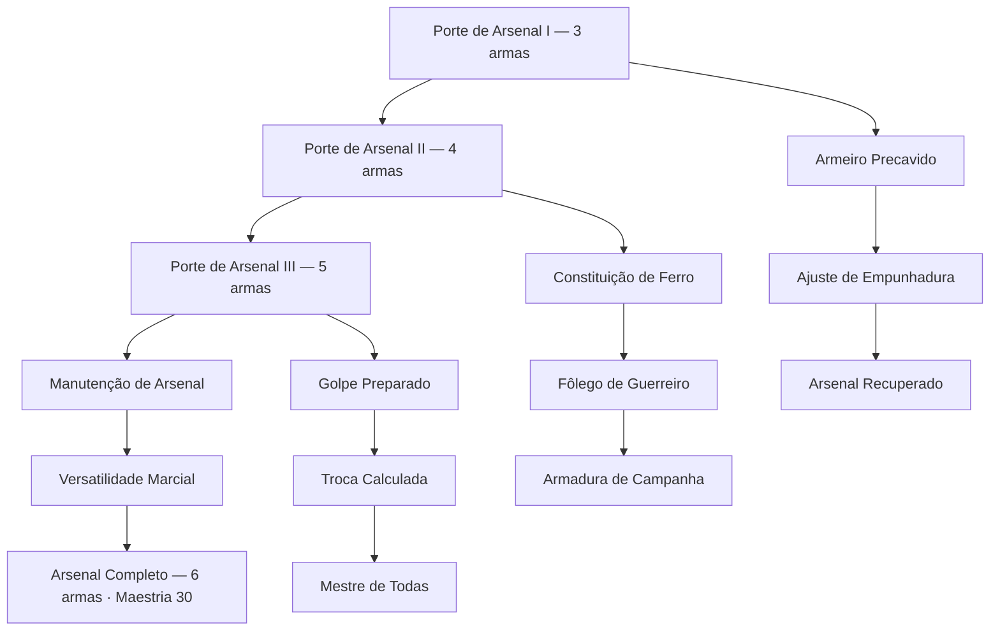

# Kylast — árvore de maestria aprovada

Conexões aprovadas pelo autor em 01/11/2026. Nível máximo 30; um ponto por nível par; 15 pontos e 15 nós. Cada nó custa um ponto. Todos podem ser adquiridos. Redistribuição apenas fora da run por 200 gold.

Cada seta define o pré-requisito direto. O primeiro nó não exige outro talento. Ramos laterais não precisam ser completados para continuar na trilha central. Apenas Arsenal Completo exige adicionalmente maestria 30. Kylast começa com capacidade de duas armas.

| Nó | Benefício |
|---|---|
| Porte de Arsenal I | Capacidade de 3 armas. |
| Porte de Arsenal II | Capacidade de 4 armas. |
| Porte de Arsenal III | Capacidade de 5 armas. |
| Manutenção de Arsenal | Primeiro equipamento que voltar à sua mão em cada rodada custa 1 a menos para reequipar naquela rodada. |
| Versatilidade Marcial | Uma vez por rodada, equipar em Kylast uma arma diferente das que já carrega concede +1 de ataque nessa rodada. |
| Arsenal Completo | Capacidade de 6 armas. |
| Armeiro Precavido | No início da batalha, compre um equipamento do deck. |
| Ajuste de Empunhadura | Primeiro equipamento colocado em Kylast na batalha custa 1 mana a menos. |
| Arsenal Recuperado | Uma vez por batalha, quando Kylast entra em campo, compre um equipamento do deck. |
| Constituição de Ferro | +1 de vida base de Kylast nas duas formas. |
| Fôlego de Guerreiro | Uma vez por batalha, ao sobreviver a dano, Kylast recupera 2 de vida. |
| Armadura de Campanha | Primeira entrada de Kylast na batalha concede +2 de vida como efeito de armadura. |
| Golpe Preparado | Primeiro golpe do primeiro ataque de Kylast na batalha recebe +1 de dano. |
| Troca Calculada | Evoluído, usar armas diferentes nos dois golpes concede +1 de dano ao segundo. |
| Mestre de Todas | Ao evoluir, Kylast recebe +1 de ataque permanente naquela batalha. |

Descontos não geram custo negativo. Equipamentos incluem Banjo e Colar, conforme definição do autor. Vida de armadura segue as regras já aprovadas de acréscimo de vida, sem cura. Este documento consolida a árvore aprovada; regras gerais do deck e combate continuam em CAMPANHA.md. Nenhuma implementação foi feita nesta etapa.

## Benefícios automáticos em eventos — aprovados

Separados dos 15 nós, sem gastar pontos: nível 5 +1 em testes de Força; nível 10 vantagem em desafios de força física; nível 15 +1 em testes de Constituição; nível 20 vantagem em desafios de resistência física; nível 25 uma nova tentativa de teste falho por run, com o mesmo participante e modificadores, substituindo o resultado anterior. O uso não é restaurado ao voltar ao checkpoint. Especialidades de Kylast: Força e Constituição. Esses benefícios não alteram seus atributos de combate.
